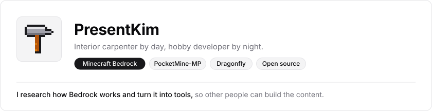
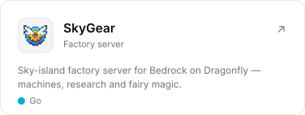
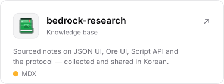
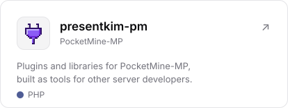
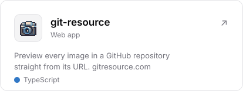

<picture><source media="(prefers-color-scheme: dark)" srcset="./assets/header-dark.svg"></picture>

<a href="https://github.com/PresentKim/SkyGear"><picture><source media="(prefers-color-scheme: dark)" srcset="./assets/skygear-dark.svg"></picture></a>
<a href="https://github.com/PresentKim/bedrock-research"><picture><source media="(prefers-color-scheme: dark)" srcset="./assets/research-dark.svg"></picture></a>
 
<a href="https://github.com/presentkim-pm"><picture><source media="(prefers-color-scheme: dark)" srcset="./assets/pmmp-dark.svg"></picture></a>
<a href="https://github.com/PresentKim/git-resource"><picture><source media="(prefers-color-scheme: dark)" srcset="./assets/gitres-dark.svg"></picture></a>

가볍고 즐겁게 만들고, 알게 된 것은 나눕니다 · Built light, shared openly

