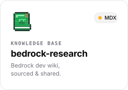
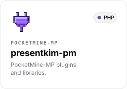
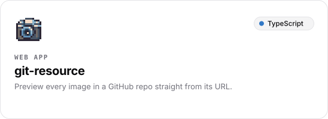

<picture><source media="(prefers-color-scheme: dark)" srcset="./assets/hero-dark.svg"></picture>

<a href="https://github.com/PresentKim/SkyGear"><picture><source media="(prefers-color-scheme: dark)" srcset="./assets/skygear-dark.svg"></picture></a>
<a href="https://github.com/PresentKim/bedrock-research"><picture><source media="(prefers-color-scheme: dark)" srcset="./assets/research-dark.svg"></picture></a>
 
<a href="https://github.com/presentkim-pm"><picture><source media="(prefers-color-scheme: dark)" srcset="./assets/pmmp-dark.svg"></picture></a>
<a href="https://github.com/PresentKim/git-resource"><picture><source media="(prefers-color-scheme: dark)" srcset="./assets/gitres-dark.svg"></picture></a>

<picture><source media="(prefers-color-scheme: dark)" srcset="./assets/values-dark.svg"></picture>

