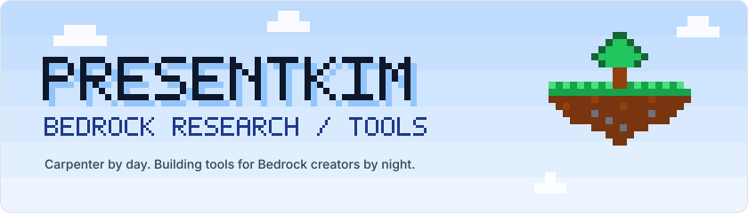
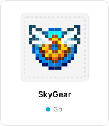
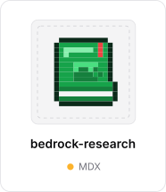
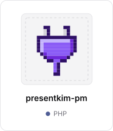
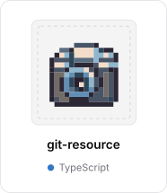

   

> 직접 콘텐츠를 찍어내기보다, 배드락의 새로운 기술을 연구해서 **다른 개발자들이 콘텐츠를 만들 수 있는 환경**을 만드는 걸 좋아합니다.
> 오픈 소스에서 받은 만큼, 알게 된 것은 나눕니다.

- [**SkyGear**](https://github.com/PresentKim/SkyGear) — Sky-island factory server for Bedrock (Go · Dragonfly)
- [**bedrock-research**](https://github.com/PresentKim/bedrock-research) — Bedrock JSON UI · Ore UI · Script API · protocol wiki
- [**presentkim-pm**](https://github.com/presentkim-pm) — PocketMine-MP plugins & libraries
- [**git-resource**](https://github.com/PresentKim/git-resource) — Preview images of any GitHub repo · [gitresource.com](https://gitresource.com)
