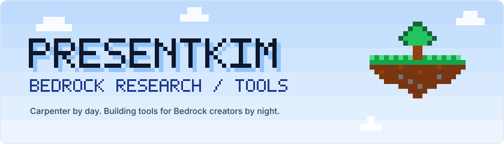
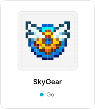
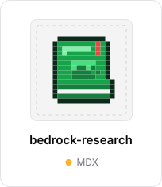
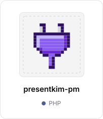
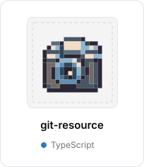

<picture><source media="(prefers-color-scheme: dark)" srcset="./assets/banner-dark.svg"></picture>

<a href="https://github.com/PresentKim/SkyGear"><picture><source media="(prefers-color-scheme: dark)" srcset="./assets/skygear-dark.svg"></picture></a>
<a href="https://github.com/PresentKim/bedrock-research"><picture><source media="(prefers-color-scheme: dark)" srcset="./assets/research-dark.svg"></picture></a>
<a href="https://github.com/presentkim-pm"><picture><source media="(prefers-color-scheme: dark)" srcset="./assets/pmmp-dark.svg"></picture></a>
<a href="https://github.com/PresentKim/git-resource"><picture><source media="(prefers-color-scheme: dark)" srcset="./assets/gitres-dark.svg"></picture></a>

> 직접 콘텐츠를 찍어내기보다, 배드락의 새로운 기술을 연구해서 **다른 개발자들이 콘텐츠를 만들 수 있는 환경**을 만드는 걸 좋아합니다.
> 오픈 소스에서 받은 만큼, 알게 된 것은 나눕니다.

- [**SkyGear**](https://github.com/PresentKim/SkyGear) — Sky-island factory server for Bedrock (Go · Dragonfly)
- [**bedrock-research**](https://github.com/PresentKim/bedrock-research) — Bedrock JSON UI · Ore UI · Script API · protocol wiki
- [**presentkim-pm**](https://github.com/presentkim-pm) — PocketMine-MP plugins & libraries
- [**git-resource**](https://github.com/PresentKim/git-resource) — Preview images of any GitHub repo · [gitresource.com](https://gitresource.com)
